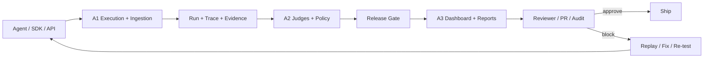

# Ashr Codex Factory

> Agent release intelligence: run agents, grade behavior, replay failures, and turn evidence into a release decision.

Ashr Codex Factory is a local-first reproduction and productization lab for an agent evaluation SaaS. It is organized as three connected systems:

- **A1 - Execution, SDK, and ingestion core**: Python/TypeScript agent runners, trace capture, local cloud API facade, queue replay, SaaS-style control plane contracts, durable Postgres backend slices, API-key guarded Go ingress, API calibration, quota guardrails, and redacted evidence indexing.
- **A2 - Evaluation intelligence**: deterministic judges, scenario selection, failure taxonomy, release policies, judge versioning, regression candidates, commercial readiness, and result-persistence contracts.
- **A3 - Product and release control tower**: modular dashboard, product console, SaaS admin shell, report center, hosted-report contracts, audit bundles, GitHub/PR gate payloads, redaction firewall, governance and billing-readiness contracts, self-host console contracts, and exportable JSON/CSV/Markdown evidence.

The current repository is not a finished hosted SaaS. It is a fast-growing, test-backed product factory that already models much of the SaaS contract locally: multi-tenant shapes, SDK ingestion, release gates, audit artifacts, usage ledgers, report sharing, and admin workflows.

---

## Product Thesis

AI agents fail differently from ordinary software. A bad release may call the wrong tool, pass unsafe arguments, skip required clarification, hallucinate tool output, leak secrets, or silently degrade after a prompt/model change.

Ashr Codex Factory is built around one rule:

> Do not ship an agent until its run, trace, judge result, release gate, and audit evidence can be inspected and replayed.



---

## What Works Now

### Latest Sync Snapshot

As of the current main-sync branch, the repo has absorbed the A3 commercial growth Round 4 work and the latest A1 local SDK runner work. In plain terms: A3 now has stronger product governance, billing-readiness, denied-state, and E2E evidence surfaces; A1 now has deeper durable backend contracts for Postgres-backed worker jobs, uploads, traces, artifact manifests, quota/audit ledgers, Go ingress authentication handles, and Python/TypeScript parity evidence.

The product is still local-first and contract-backed, not a hosted production SaaS. The important change is that more of the SaaS backend and commercial product workflow is now represented by tested code paths instead of only documents or fixtures.

### A1 - Execution and SaaS Ingestion

- Python and TypeScript agent adapters.
- Batch runners with timeout, failure, trace, and replay fixture output.
- Local cloud API runtime with tenant/project/dataset/request/run records.
- Queue worker, deterministic replay, state export, cancellation paths, lease lifecycle, and dead-letter handling.
- Durable Postgres backend slices for tenants, projects, datasets, runs, worker jobs, uploads, trace batches, artifact manifests, idempotency, quota/audit ledgers, and readback parity.
- Go ingress surfaces with API-key authentication handles and redacted error envelopes for local SaaS-style routes.
- Python and TypeScript SDK parity for agent inputs, media parts, run results, traces, quota checks, calibration gates, control-plane calls, and local cloud workflows.
- SaaS-style ingestion/control-plane contracts for API keys, upload/trace lifecycle, idempotency, usage accounting, and redacted errors.
- Hosted API calibration path with dry-run-first safety, quota gates, protected outputs, and public-safe evidence index generation.

### A2 - Evaluation Intelligence

- Deterministic judges for tool policy, outcome, trace integrity, grounding, and safety boundary behavior.
- Scenario selection and project selection profiles.
- Failure taxonomy covering wrong intent, missing/forbidden tools, wrong arguments/order, hallucinated tool output, ignored evidence, unsafe output, and poor recovery.
- Release policy and release gate report generation.
- Judge versioning, service wrapper, result persistence manifest, incident regression candidates, and commercial readiness fixtures.
- A2 outputs feed A3 dashboards, report exports, release gates, and regression planning.

### A3 - Product Control Tower

- Modular dashboard webapp under `apps/dashboard/`.
- Local API server and fixture-backed store.
- Product console for onboarding, project state, imports, audit workflow, and release readiness.
- SaaS admin shell for login/team/API-key/usage/trust flows, kept local and plan-safe.
- Report Center, hosted report lifecycle, share-token contracts, usage ledger, SQL migration plan, and self-host readiness contract.
- Gate CLI with GitHub check payloads, PR comments, waiver/approval validation, generated artifact manifest, audit bundle index, bundle verification, and redaction firewall.
- Commercial growth Round 4 contracts for governance evidence, billing-readiness, reviewer/denied-state E2E flows, and identity-safe placeholders.
- Exportable reports in JSON, CSV, Markdown, and print-oriented dashboard views.

---

## SaaS Boundary

The repo currently behaves like a **local SaaS contract simulator plus evaluation product prototype**. It is strong enough to demonstrate the product logic and integration boundaries, but it is not yet a production hosted service.

| Area | Current State | SaaS Gap |
|---|---|---|
| SDK ingestion | Python/TS local SDKs, cloud facade, quota/idempotency contracts, calibration parity evidence, and Go ingress handles | Publishable packages, versioned public API, long-running compatibility policy |
| Multi-tenancy | Tenant/project/dataset/run models and scoped local services | Real auth, org membership, RBAC, tenant isolation enforced by a production DB/API layer |
| Evaluation | Deterministic judges, scenario packs, release gates, regression candidates | Hosted judge service, configurable policies, semantic/LLM judge calibration at scale |
| Storage | Fixture-backed reports plus expanding Postgres-backed tenants/projects/runs/jobs/uploads/traces/artifacts/usage/audit contracts | Full production Postgres/object storage/queue deployment, migrations, backups, retention jobs |
| Product UI | Modular dashboard, product console, SaaS admin shell, hosted report contracts, governance and billing-readiness views | Real login, server-backed mutations, collaborative review workflows, production UX QA |
| Audit/compliance | Redaction firewall, audit bundle, root hash, verifier, evidence manifests | Immutable storage, signatures, access logs, enterprise retention, SSO/SOC2-style controls |
| Operations | Local tests and command-driven verification | CI/CD, environments, monitoring, alerts, SLOs, incident response, deployment automation |
| Billing/usage | Usage ledger, quota contracts, billing-readiness evidence, and local plan-safe surfaces | Payment plans, metering pipeline, invoices, plan enforcement, admin billing UI |

---

## Quickstart

```bash
git clone https://github.com/3351666087/ashr-codex-factory.git
cd ashr-codex-factory
```

Run the Python test suite:

```bash
python -m pytest tests/a1 tests/a2 -q
```

Run the A3 Node test suite:

```bash
node --test tests/a3/*.mjs
```

Run the TypeScript SDK tests:

```bash
npm install --prefix packages/ts/ashr-clone
npm test --prefix packages/ts/ashr-clone
```

Start the dashboard:

```bash
python -m http.server 5173
```

Open:

```text
http://127.0.0.1:5173/apps/dashboard/index.html
```

---

## Run an Agent Locally

```bash
python -B -m services.runner.cli \
  --input docs/a1/evidence/local_agent_cases_30.json \
  --output /tmp/ashr_local_run.json \
  --agent examples.agents.mock_agent:RespondingMockAgent \
  --dataset-id a2-local-scenarios \
  --runner-id local-smoke \
  --max-workers 4 \
  --timeout 5 \
  --fail-on-case-failure
```

Run local cloud queue replay:

```bash
python -B -m services.api.cli run-agent-queued \
  --input docs/a1/evidence/local_agent_cases_30.json \
  --agent examples.agents.mock_agent:RespondingMockAgent \
  --fixture-output /tmp/ashr_queue_fixture.json \
  --summary-output /tmp/ashr_queue_summary.json \
  --run-output /tmp/ashr_queue_run.json \
  --tenant-id tenant_demo \
  --project-id project_demo \
  --dataset-id dataset_demo \
  --runner-id queue-demo \
  --queue-workers 4 \
  --max-workers 4 \
  --timeout 5 \
  --wait-timeout 30 \
  --fail-on-case-failure
```

Generate A2 fixtures:

```bash
python scripts/a2_regenerate_fixtures.py --check
```

Run the A3 release gate CLI:

```bash
node services/report/a3_gate_cli.mjs \
  --runs fixtures/a3/mock_run_results.json \
  --grades fixtures/a3/mock_grade_results.json \
  --coverage fixtures/a2/results/a2_g3_coverage_report.json \
  --thresholds fixtures/a3/release_gate_thresholds.json \
  --json \
  --no-fail
```

---

## Repository Map

```text
apps/dashboard/                  A3 modular dashboard webapp
services/runner/                 A1 local runner, dataset adapter, API probe
services/api/                    A1 local cloud API, queue worker, control plane
services/judge/                  A2 judges, release policy, scenario selection, persistence
services/report/                 A3 reports, gate CLI, product/admin/report-center services
packages/sdk/ashr_clone/         Python SDK-style runtime and evidence helpers
packages/ts/ashr-clone/          TypeScript SDK/runtime/probe/cloud parity package
packages/go/ashrclone/            Go API/runtime, Postgres, auth, and local SaaS ingress slices
packages/rust/ashr-runtime-verify/ Static runtime fixture verifier
packages/scenarios/              A2 scenario packs
fixtures/a2/                     A2 generated reports, readiness, policy, persistence fixtures
fixtures/a3/                     A3 run/grade/dashboard/gate/audit fixtures
docs/a1/                         A1 schemas, API calibration, SDK and evidence notes
docs/a2/                         A2 schemas, taxonomy, case book, readiness docs
docs/a3/                         A3 product, audit, SaaS, report center, self-host docs
docs/strategy/                   Current A1/A2/A3 large SaaS roadmap bus
tests/a1/                        A1 Python tests
tests/a2/                        A2 Python tests
tests/a3/                        A3 Node tests
```

---

## Evidence Discipline

Evidence is treated as a product feature.

Public tracked files may contain:

- schema names and field names
- redacted status summaries
- fixture shapes
- public-safe readiness reports
- hash and manifest metadata
- deterministic test outputs

Public tracked files must not contain:

- API keys or bearer tokens
- raw private prompts/responses
- account payloads
- unredacted quota values
- private screenshots
- customer data

Private operational artifacts belong under ignored evidence paths such as:

```text
docs/evidence/private_refs/
```

---

## Current Direction

The current main branch is pushing from local factory toward hosted SaaS in this order:

1. **A1** turns the runner/SDK into production ingestion and platform backend contracts, with durable Postgres and Go ingress slices now becoming the main hardening path.
2. **A2** turns deterministic judges into a configurable evaluation intelligence service.
3. **A3** turns local evidence into a real product workflow: release gate, reviewer workflow, report center, governance/billing readiness, audit bundle, admin console, and self-host readiness.

The central roadmap bus is:

```text
docs/strategy/large-saas-a1-a2-a3-full-plan.md
```

The shortest path to a real SaaS is not adding another demo page. It is replacing fixture-backed contracts with production services while preserving the evidence chain that already works locally.
