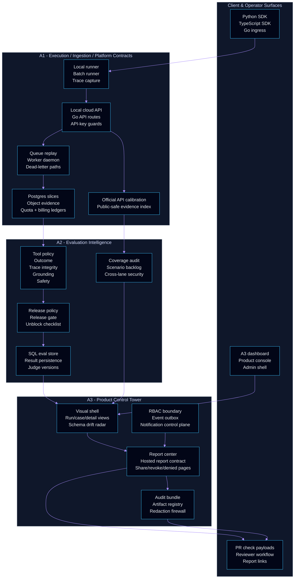
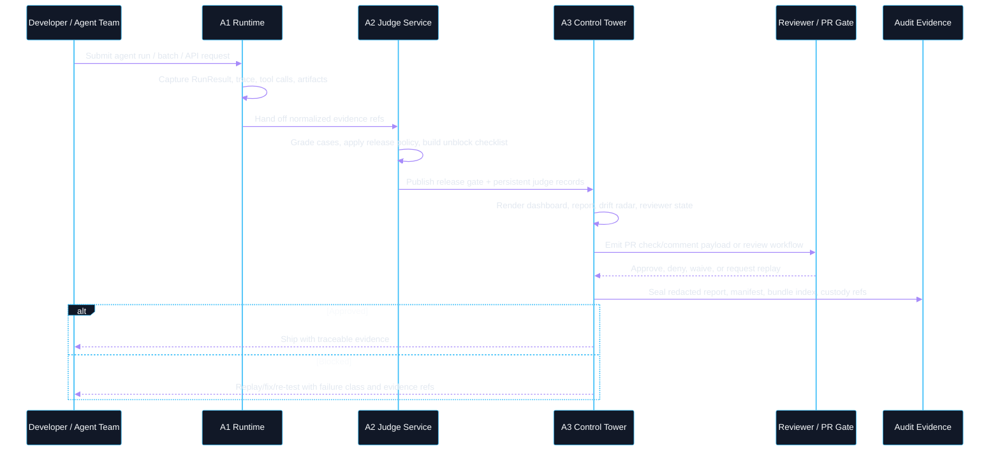
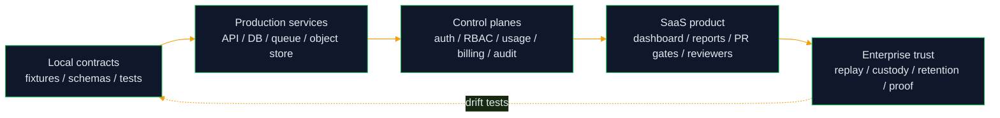

<div align="center">

# Ashr Codex Factory

### Agent Release OS | Evidence Factory | Evaluation Intelligence | SaaS Control Tower

<p>
  
  
  
</p>
<p>
  
  
  
</p>

> **Do not ship an agent until its run, trace, judge result, release gate, and audit evidence can be inspected, replayed, and defended.**

</div>

---

## What this repo is

**Ashr Codex Factory** is a fast-growing product factory for an agent-evaluation SaaS. It is not just a demo dashboard and it is not yet a production hosted service. It is the local, test-backed substrate for an **Agent Release OS**:

- run agents and capture trace/evidence;
- grade behavior through deterministic evaluation intelligence;
- block or approve risky releases through policy gates;
- package redacted audit evidence for reviewers, PRs, reports, and future enterprise workflows;
- evolve toward multi-tenant SaaS with auth, RBAC, usage, billing, object storage, workers, and audit custody.

The codebase is intentionally split into three lanes that grow together:

| Lane | Mission | Current center of gravity |
|---|---|---|
| **A1 - Execution & Ingestion Core** | Connect agents, SDKs, APIs, queues, storage, quota, billing, and evidence capture. | Python/TS SDK parity, Go ingress, Postgres-backed SaaS slices, worker daemon, object evidence, billing/quota ledgers, public-safe official API calibration. |
| **A2 - Evaluation Intelligence** | Turn traces into trusted pass/fail, failure taxonomy, scenario coverage, release policies, and persistent judge records. | 60-scenario G3 pack, deterministic judges, release gate, SQL evaluation store contract, cross-lane security context, scenario backlog, result persistence. |
| **A3 - Product Control Tower** | Turn evidence into product workflows: dashboard, reports, reviewer gates, audit bundles, admin surfaces, and commercial readiness. | Modular dashboard, visual shell, commercial OpenAPI contract, RBAC metadata boundary, event outbox, live ops/notification control plane, billing migration readiness, report sharing. |

---

## Latest integrated main snapshot

This README describes the integrated **A1 + A2 + A3** mainline state after the latest lane sync.

| Signal | Snapshot |
|---|---:|
| A1 public-safe real API evidence records | **401** |
| A1 commercial capability matrix entries | **122** |
| A2 generated fixture files checked by `scripts/a2_regenerate_fixtures.py` | **55** |
| A2 G3 scenarios | **60** |
| A2 calibration cases visible to readiness | **6** |
| A3 commercial API endpoints tracked in contract | **34** |
| A3 endpoints implemented or read-only locally | **21** |

### What changed in this sync

- **A1 moved closer to a real SaaS spine**: durable Postgres API keys, route scopes, quota gates, billing ledger migration/replay, payment-provider readiness, local object evidence, worker daemon storage, Go API evidence gates, commercial self-host compose scaffolds, and public-safe official API readiness packets.
- **A2 moved from judge library toward evaluation intelligence service**: SQL-readable evaluation store, cross-lane security context, A1 billing/payment/API evidence consumption, scenario generation backlog, release unblock contract, persistent judge records, and regenerated fixtures against latest A1 evidence.
- **A3 moved from dashboard/reporting toward control tower**: polished visual shell, commercial OpenAPI surface, fail-closed RBAC write-path contract, event outbox backbone, schema drift radar, reviewer denial flow, live ops readiness, notification control plane, billing migration readiness, and A1/A2 source-artifact consumers.

> The repository remains **local-first and contract-backed**. Live customer billing, production SSO/RBAC, immutable enterprise storage, and live GitHub enforcement are deliberately future-boundary work until the corresponding backend and operator approvals exist.

---

## Product thesis

AI agents fail differently from ordinary software:

- they call the wrong tool;
- they pass unsafe arguments;
- they skip required clarification;
- they hallucinate tool output;
- they leak secrets;
- they silently degrade after prompt/model/tooling changes.

Ashr's answer is an evidence chain that is visible from run to release:

```mermaid
%%{init: {"theme": "base", "themeVariables": {"background": "transparent", "primaryColor": "#111827", "primaryTextColor": "#f8fafc", "primaryBorderColor": "#8b5cf6", "lineColor": "#22d3ee", "secondaryColor": "#0f172a", "tertiaryColor": "#1e293b", "fontFamily": "Inter, ui-sans-serif, system-ui"}}}%%
flowchart LR
  classDef a1 fill:#312e81,stroke:#a78bfa,color:#f8fafc,stroke-width:2px
  classDef a2 fill:#164e63,stroke:#67e8f9,color:#ecfeff,stroke-width:2px
  classDef a3 fill:#78350f,stroke:#fbbf24,color:#fff7ed,stroke-width:2px
  classDef artifact fill:#111827,stroke:#94a3b8,color:#e5e7eb,stroke-width:1.5px
  classDef decision fill:#064e3b,stroke:#34d399,color:#ecfdf5,stroke-width:2px

  Agent["Agent / SDK / API"]:::artifact --> A1["A1 - Execute + Ingest"]:::a1
  A1 --> Trace["RunResult / Trace / ToolCalls / Evidence"]:::artifact
  Trace --> A2["A2 - Grade + Policy"]:::a2
  A2 --> Gate["ReleaseGate / Failure Taxonomy / Regression Plan"]:::artifact
  Gate --> A3["A3 - Control Tower"]:::a3
  A3 --> Review["Reviewer / PR / Report / Audit Bundle"]:::artifact
  Review --> Decision{"Ship?"}:::decision
  Decision -->|approve| Ship["Release with custody trail"]:::decision
  Decision -->|block| Replay["Replay / Fix / Re-test"]:::artifact
  Replay --> A1
```



---

## System architecture



---

## Lane capabilities

### A1 - Execution & SaaS ingestion core

A1 owns the runtime substrate and evidence boundary.

- Python and TypeScript agent adapters, local runner shapes, trace capture, replay fixture output, timeout/failure behavior, and SDK parity evidence.
- Local cloud API facade with tenant/project/dataset/request/run records, idempotency, cancellation, queue replay, state export, and dead-letter handling.
- Go ingress surfaces with API-key authentication handles, route-scope manifest, redacted error envelopes, and Postgres backend migration slices.
- Durable Postgres contracts for tenants, projects, runs, upload traces, artifacts, API keys, worker jobs, quota ledgers, audit chains, billing ledgers, and replay parity.
- Self-host scaffolds through Docker Compose and Terraform-shaped artifacts for local Postgres/Redis/MinIO/API/worker/billing-webhook boundaries.
- Official API calibration path that is dry-run first, quota-aware, public-safe, and explicitly separated from ignored private evidence.

### A2 - Evaluation intelligence

A2 owns whether behavior is trustworthy enough to release.

- Deterministic judges for tool policy, outcome, trace integrity, grounding, safety boundary behavior, recovery quality, and hallucinated tool-result detection.
- G3 scenario coverage with 60 scenarios, golden cases, executable calibration fixtures, failure taxonomy, media/tool-output grounding, and regression replay.
- Release policy engine, release gate report, release unblock checklist, result persistence manifest, judge version registry, and service-wrapper OpenAPI boundary.
- New SQL evaluation store contract for grade results, calibration data, golden cases, and regression history.
- New cross-lane security context consuming A1 route/auth/quota evidence and A3 RBAC/outbox signals without taking ownership of auth or dashboard UI.
- New scenario generation backlog that turns coverage gaps, policy experiments, and regression signals into promotable future cases.

### A3 - Product control tower

A3 owns the operator experience: what reviewers see, approve, deny, export, and audit.

- Modular dashboard under `apps/dashboard/` with product-console visuals, run/case views, failure clusters, media metadata, report center, and polished visual shell/navigation.
- Commercial OpenAPI contract spanning dashboard, release gate, report center, artifact registry, review workflow, admin console, usage/billing, trust, and notification surfaces.
- Local API server/store, SQLite contract, hosted-report lifecycle, share token/revoke/denied states, report print/export flows, and redaction-aware report generation.
- RBAC metadata boundary, fail-closed write-path rules, event envelope/outbox backbone, live ops control plane, notification control plane, and schema drift radar across A1/A2/A3 contracts.
- Gate CLI with JSON/Markdown payloads, GitHub check and PR comment dry-run evidence, waiver/approval validation, readback-shaped contracts, audit bundle index, bundle verification, and artifact registry.

---

## Release lifecycle



---

## Quickstart

```bash
git clone https://github.com/3351666087/ashr-codex-factory.git
cd ashr-codex-factory
```

Run the core Python checks:

```bash
python -B -m pytest tests/a1 tests/a2 -q
```

Check deterministic A2 fixture reproducibility:

```bash
python -B scripts/a2_regenerate_fixtures.py --check
```

Run the A3 Node contracts:

```bash
node --test tests/a3/*.mjs
```

Run the TypeScript SDK package tests:

```bash
npm install --prefix packages/ts/ashr-clone
npm test --prefix packages/ts/ashr-clone
```

Run the Go runtime/API tests:

```bash
cd packages/go/ashrclone
go test ./...
```

Start the local dashboard:

```bash
python -m http.server 5173
```

Open:

```text
http://127.0.0.1:5173/apps/dashboard/index.html
```

---

## Common workflows

Run an agent locally:

```bash
python -B -m services.runner.cli \
  --input docs/a1/evidence/local_agent_cases_30.json \
  --output /tmp/ashr_local_run.json \
  --agent examples.agents.mock_agent:RespondingMockAgent \
  --dataset-id a2-local-scenarios \
  --runner-id local-smoke \
  --max-workers 4 \
  --timeout 5 \
  --fail-on-case-failure
```

Run local cloud queue replay:

```bash
python -B -m services.api.cli run-agent-queued \
  --input docs/a1/evidence/local_agent_cases_30.json \
  --agent examples.agents.mock_agent:RespondingMockAgent \
  --fixture-output /tmp/ashr_queue_fixture.json \
  --summary-output /tmp/ashr_queue_summary.json \
  --run-output /tmp/ashr_queue_run.json \
  --tenant-id tenant_demo \
  --project-id project_demo \
  --dataset-id dataset_demo \
  --runner-id queue-demo \
  --queue-workers 4 \
  --max-workers 4 \
  --timeout 5 \
  --wait-timeout 30 \
  --fail-on-case-failure
```

Run the A2 internal judge wrapper:

```bash
python scripts/a2_judge_service.py /internal/judge/case --input payload.json
python scripts/a2_judge_service.py /internal/release-policy/evaluate --input payload.json
```

Run the A3 release gate CLI:

```bash
node services/report/a3_gate_cli.mjs \
  --runs fixtures/a3/mock_run_results.json \
  --grades fixtures/a3/mock_grade_results.json \
  --coverage fixtures/a2/results/a2_g3_coverage_report.json \
  --thresholds fixtures/a3/release_gate_thresholds.json \
  --json \
  --no-fail
```

Validate local self-host compose contracts:

```bash
docker compose -f services/runner/docker-compose.a1.yml config --quiet
docker compose --env-file infra/docker/self-host.env.example \
  -f infra/docker/docker-compose.self-host.yml \
  --profile commercial config --quiet
```

---

## Repository map

```text
apps/dashboard/                    A3 modular dashboard, visual shell, product console
services/runner/                   A1 local runner, dataset adapter, API probes
services/api/                      A1 local cloud API, queue replay, control plane, billing helpers
services/judge/                    A2 judges, release policy, SQL store, scenario backlog, persistence
services/report/                   A3 reports, gate CLI, artifact registry, RBAC/outbox/control-plane services
packages/sdk/ashr_clone/           Python SDK-style runtime and evidence helpers
packages/ts/ashr-clone/            TypeScript SDK/runtime/probe/cloud parity package
packages/go/ashrclone/             Go API/runtime, Postgres, auth, quota, worker and SaaS ingress slices
packages/rust/ashr-runtime-verify/ Static runtime fixture verifier
packages/scenarios/                A2 scenario packs
fixtures/a2/                       A2 generated grades, coverage, readiness, SQL, persistence fixtures
fixtures/a3/                       A3 dashboard/gate/audit/report/admin/readback fixtures
docs/a1/                           A1 schemas, API calibration, billing/quota/storage evidence
docs/a2/                           A2 schemas, taxonomy, service contract, worklogs
docs/a3/                           A3 product, SaaS, audit, report center, visual and growth docs
docs/strategy/                     A1/A2/A3 large-SaaS roadmap bus
infra/docker/                      Self-host compose profile and env examples
infra/terraform/                   Self-host infrastructure-shaped contracts
tests/a1/                          A1 Python contract tests
tests/a2/                          A2 Python judge/readiness tests
tests/a3/                          A3 Node contract tests
```

---

## Evidence discipline

Evidence is a product feature. Public tracked files may contain:

- schema names and field names;
- redacted status summaries;
- fixture shapes;
- public-safe readiness reports;
- hash and manifest metadata;
- deterministic test outputs;
- path-only pointers to ignored private evidence.

Public tracked files must not contain:

- API keys, bearer tokens, cookies, or raw share tokens;
- raw private prompts/responses;
- account payloads or customer data;
- unredacted quota/payment/provider values;
- private screenshots or signed media URLs.

Private operational artifacts belong under ignored paths such as:

```text
docs/evidence/private_refs/
```

---

## SaaS boundary and next direction

| Layer | Strong local contract now | Still future-boundary |
|---|---|---|
| Ingestion | SDK parity, Go ingress, Postgres slices, quota and object-evidence contracts | Published hosted API, long-running compatibility policy, production auth middleware |
| Evaluation | Deterministic judges, release policies, SQL evaluation store, scenario backlog | Hosted judge service, configurable enterprise policies, semantic/LLM calibration at scale |
| Product UI | Dashboard, product console, report center, review workflow, drift radar | Full Next.js/React SaaS app, collaborative live mutations, production UX QA |
| Governance | RBAC metadata, outbox/event envelopes, audit bundle, redaction firewall | Real SSO/OIDC, immutable storage, signed approvals, retention/SOC2 controls |
| Billing | Ledger/replay/migration readiness and read-only A3 billing surfaces | Payment provider checkout, invoices, quotas enforced by live provider webhooks |
| GitHub/CI | Dry-run check/comment payloads and readback-shaped evidence | Live required checks, branch protection changes, artifact upload with maintainer approval |

The shortest path to real SaaS is not another mock page. It is replacing fixture-backed contracts with production services while preserving the evidence chain that already works locally:



<div align="center">

**Ashr = the release gate, evidence ledger, evaluation brain, and control tower for AI agents.**

</div>
