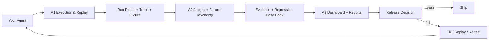
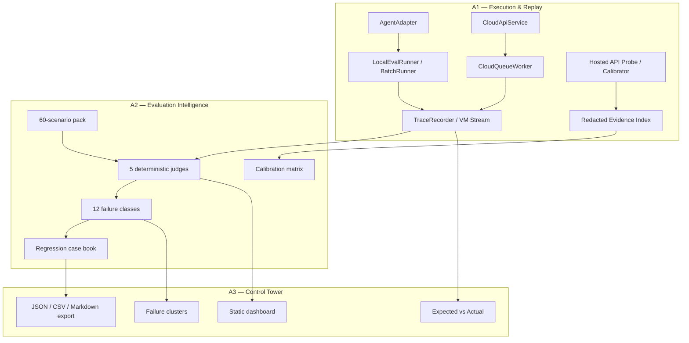

# Ashr Codex Factory

> **Ship agents only when the evidence says yes.**

Ashr Codex Factory is a local-first reproduction and productization lab for an **Agent Release Intelligence Platform**: run agents, capture traces, judge behavior, replay failures, and turn every result into evidence that a release reviewer can inspect.

This repository is not a toy dashboard and not a vague eval script. It is a working factory for three connected systems:

- **A1 — Execution & Replay Core**: agent adapters, local runners, queue replay, trace fixtures, TypeScript/Python SDK parity, and quota-safe hosted API calibration.
- **A2 — Evaluation Intelligence**: deterministic judges, scenario packs, failure taxonomy, calibration matrix, regression case book, and commercial readiness gates.
- **A3 — Product Control Tower**: local dashboard, triage views, failure clusters, expected-vs-actual diffs, and JSON/CSV/Markdown reports.

Maintained by **3351666087**.

---

## The product idea

Modern AI agents do not fail like ordinary software. They call the wrong tool, pass the wrong arguments, hallucinate a tool result, skip a required clarification, leak unsafe content, or quietly degrade after a prompt change.

Ashr Codex Factory is built around one hard rule:

> **An agent should not ship until its run, trace, judge result, and release evidence can be replayed.**



---

## What it can do today

### Run and record agents

A1 can wrap Python or TypeScript agents, run case batches, capture observations, normalize tool calls, emit A3-consumable run fixtures, and replay queued state.

It supports:

- `respond(message)` style agents
- callable agents
- Python and TypeScript local runners
- trace/VM-stream style fixture output
- queue state snapshots and deterministic replay
- local tenant/project/dataset/request/run records
- quota-ledger checks before writes
- safe redaction of secrets, tokens, bearer values, emails, and signed URLs

### Judge agent behavior

A2 can grade runs through five deterministic judge modes:

1. **Tool policy judge** — required/forbidden tools, wrong tools, wrong arguments, wrong order.
2. **Outcome judge** — final response contract, missing keywords, forbidden content, missing clarification.
3. **Trace integrity judge** — trace shape, normalized args, timeout/error recovery, assistant observation presence.
4. **Grounding judge** — ignored tool results, hallucinated facts, missing factual support.
5. **Safety boundary judge** — unsafe markers and secret-like leakage.

A2 classifies failures into a canonical taxonomy:

```text
wrong_intent
missing_required_tool
unnecessary_tool_call
forbidden_tool_call
wrong_tool
wrong_arguments
wrong_tool_order
missing_clarification
hallucinated_tool_result
ignored_tool_result
unsafe_or_policy_violation
poor_failure_recovery
```

### Show and export the evidence

A3 provides a static local product console for:

- run list
- case detail
- trace timeline
- expected vs actual
- failure clusters
- media evidence summaries
- A2 coverage/readiness overlays
- JSON, CSV, and Markdown report export

Start it locally:

```bash
python -m http.server 5173
```

Then open:

```text
http://127.0.0.1:5173/apps/dashboard/index.html
```

---

## Quickstart

### 1. Clone

```bash
git clone https://github.com/3351666087/ashr-codex-factory.git
cd ashr-codex-factory
```

### 2. Run Python tests

```bash
python -m pytest tests -q
```

For focused A1/A2 checks:

```bash
python -m pytest tests/a1 -q
python -m pytest tests/a2 -q
```

### 3. Run TypeScript SDK tests

```bash
npm install --prefix packages/ts/ashr-clone
npm test --prefix packages/ts/ashr-clone
```

### 4. Run an agent batch

```bash
python -B -m services.runner.cli \
  --input docs/a1/evidence/local_agent_cases_30.json \
  --output docs/evidence/private_refs/a1_local_run_smoke.json \
  --agent examples.agents.mock_agent:RespondingMockAgent \
  --dataset-id a2-local-scenarios \
  --runner-id a1-local-runner \
  --max-workers 4 \
  --timeout 5 \
  --fail-on-case-failure
```

### 5. Run local cloud replay

```bash
python -B -m services.api.cli run-agent-queued \
  --input docs/a1/evidence/local_agent_cases_30.json \
  --agent examples.agents.mock_agent:RespondingMockAgent \
  --fixture-output docs/evidence/private_refs/a1_queue_demo_fixture_smoke.json \
  --summary-output docs/evidence/private_refs/a1_queue_demo_summary_smoke.json \
  --run-output docs/evidence/private_refs/a1_queue_demo_run_smoke.json \
  --tenant-id tenant_a1_queue_smoke \
  --project-id project_a1_queue_smoke \
  --dataset-id dataset_a1_queue_smoke \
  --runner-id a1-queue-smoke \
  --queue-workers 4 \
  --max-workers 4 \
  --timeout 5 \
  --wait-timeout 30 \
  --fail-on-case-failure
```

### 6. Open the dashboard

```bash
python -m http.server 5173
```

```text
http://127.0.0.1:5173/apps/dashboard/index.html
```

---

## How to plug in your own agent

Create a Python agent with `respond(message)`:

```python
class MyAgent:
    def respond(self, message):
        return {
            "text": "The answer is 42.",
            "tool_calls": [
                {
                    "name": "calculator",
                    "arguments": {"expression": "19 + 23"},
                    "output": {"value": 42}
                }
            ]
        }
```

Create a case file:

```json
{
  "cases": [
    {
      "id": "math-001",
      "scenario_id": "calculator-contract",
      "title": "Calculator smoke test",
      "prompt": "What is 19 + 23?",
      "expected": {
        "text": "The answer is 42.",
        "tool_calls": [
          {
            "name": "calculator",
            "arguments": {"expression": "19 + 23"}
          }
        ]
      }
    }
  ]
}
```

Run it:

```bash
python -B -m services.runner.cli \
  --input my_cases.json \
  --output output/my_run.json \
  --agent my_agent:MyAgent \
  --dataset-id my-dataset \
  --runner-id my-runner \
  --max-workers 4 \
  --timeout 30 \
  --fail-on-case-failure
```

Ashr will record what the agent answered, which tools it called, which arguments it used, whether it timed out, and whether the output can be consumed by A2/A3.

---

## Repository map

```text
apps/dashboard/                  A3 static product console
services/runner/                 A1 Python local runner and hosted API probe
services/api/                    A1 local cloud API and queue worker facade
services/judge/                  A2 judges, readiness reports, calibration helpers
services/report/                 A3 report builder and Ashr result mapper
packages/sdk/ashr_clone/         Python SDK-style adapter, trace, API client helpers
packages/ts/ashr-clone/          TypeScript SDK/runtime/probe/cloud parity package
packages/scenarios/              A2 scenario packs
fixtures/a2/                     A2 calibration runs, reports, case book, readiness fixtures
fixtures/a3/                     A3 dashboard fixtures
docs/a1/                         A1 schemas, API calibration, evidence commands
docs/a2/                         A2 taxonomy, schemas, case book, readiness docs
docs/evidence/                   Public-safe evidence notes and worklog
```

---

## Architecture by layer



---

## Evidence discipline

This project treats evidence as a product feature.

Public tracked files may contain:

- schema names
- field names
- response-key summaries
- redacted status summaries
- fixture shapes
- public-safe readiness reports
- deterministic test outputs

Public tracked files must not contain:

- API keys
- bearer tokens
- raw private prompts/responses
- account payloads
- unredacted quota values
- private screenshots
- customer data

Private operational artifacts belong under ignored evidence paths such as:

```text
docs/evidence/private_refs/
```

---

## Hosted API calibration

A1 includes a dry-run-first hosted API probe path. It is designed to learn the external contract safely without leaking secrets or accidentally duplicating paid mutations.

Read-only probes can map real API fields:

```bash
python -B -m services.runner.api_probe list-requests \
  --execute \
  --max-retries 0 \
  --limit 1 \
  --output docs/evidence/private_refs/a1_api_list_requests_real.json
```

Mutating calls such as `create-request` and `create-run` are guarded by:

- explicit `--allow-mutate`
- `--max-retries 0`
- dry-run review
- quota gate records
- audited override reasons when a gate is bypassed
- redacted evidence output

This is not bureaucracy. It is the release-safety machinery a commercial agent platform needs.

---

## Current product boundary

Ashr Codex Factory is currently strong as a **local reproduction, replay, and evaluation workspace**.

It is not yet a finished hosted SaaS. The remaining commercial shell includes:

- production trace ingestion
- hosted run lifecycle matrix
- old-vs-new agent diff
- self-host worker packaging
- PR/release gate integration
- multi-tenant auth/RBAC
- enterprise audit exports
- billing/usage console
- reviewer workflow

The goal is not merely to reproduce another product. The goal is to grow this into a harder release intelligence system: one that can tell a team, with evidence, whether an agent is safe enough to ship.

---

## Development commands

```bash
# Python unit tests
python -m pytest tests -q

# A1 only
python -m pytest tests/a1 -q

# A2 only
python -m pytest tests/a2 -q

# A3 report/dashboard tests
node --test tests/a3/*.test.mjs

# TypeScript package
npm install --prefix packages/ts/ashr-clone
npm test --prefix packages/ts/ashr-clone

# A2 fixture reproducibility
python scripts/a2_regenerate_fixtures.py --check
```

---

## Why this matters

A bad agent release rarely fails with a clean exception. It fails with a plausible answer backed by a broken trace.

Ashr Codex Factory is built to catch that kind of failure:

```text
not just did it answer?
but what did it do?
what evidence supports it?
what changed since the last run?
which failure class is it?
can we replay it?
should this release be blocked?
```

That is the core of Agent Release Intelligence.
