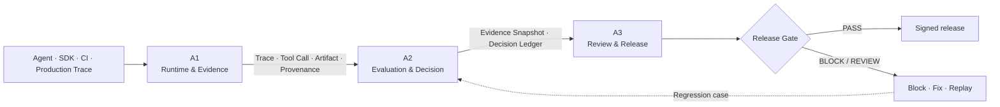

<div align="center">

# Ashr++

<p><strong>Agent Release Intelligence Platform</strong></p>

**把 Agent 的运行事实转化为可重放的证据、可解释的判断与可签字的发布决定。**

<p>
  <a href="https://github.com/3351666087/ashr-codex-factory/actions/workflows/cl-gate.yml">
    
  </a>
  
  
  
  
  
</p>

<p>
  <a href="#quickstart"><strong>Quickstart</strong></a>
  ·
  <a href="#architecture"><strong>Architecture</strong></a>
  ·
  <a href="#verification-status"><strong>Verification</strong></a>
  ·
  <a href="docs/strategy/large-saas-a1-a2-a3-full-plan.md"><strong>Strategy</strong></a>
  ·
  <a href="docs/releases/pr37-local-a1-a2-a3-integration-audit-2026-07-20.md"><strong>Audit</strong></a>
</p>

> **没有经过 Replay、Judge、Evidence、Review 与 Release Gate 的 Agent，不应该上线。**

</div>

---

## Why Ashr

Agent 上线不是一次普通的软件发布。模型、Prompt、工具调用、运行环境、策略和人工判断共同决定结果；只看一个最终分数，无法回答事故能否复现、结论由谁产生、例外由谁批准，以及上线决定是否可信。

Ashr++ 将这些问题收敛为一条可验证的发布链：

| 企业问题 | Ashr++ 的回答 |
| --- | --- |
| **这次运行到底发生了什么？** | 保存 Trace、Tool Call、Artifact、模型、Prompt、Policy 与版本身份。 |
| **失败能否稳定复现？** | 对固定 Evidence 进行 Replay、Diff 与回归重测。 |
| **为什么通过或阻断？** | 由 A2 Judge、Calibration、Policy 与 Decision Ledger 给出可追溯结论。 |
| **人工例外是否可审计？** | Review、Override、Waiver 与 Approval 只追加记录，不覆盖机器原始判断。 |
| **企业能否独立部署？** | 面向自有云、VPC、专有云和受限网络设计，不绑定单一模型 Provider。 |

Ashr++ 不是聊天壳、Prompt 集合、通用工作流搭建器，也不是只展示分数的 Dashboard。它的目标是成为 **Agent Release OS**：在候选版本进入生产前，建立统一的事实、证据、责任和发布权威。

## Architecture



### A1 / A2 / A3 authority

| Lane | 输入 | 核心责任 | 权威输出 |
| --- | --- | --- | --- |
| **A1 · Runtime & Evidence** | SDK 调用、Agent Run、Tool Call、Artifact、生产或批量 Trace | 接入、持久化、身份与租户、队列、重试、Replay、Usage、审计基础 | **可信运行事实与版本化 Evidence** |
| **A2 · Evaluation & Release Intelligence** | A1 Evidence、Scenario、Golden、Judge 配置、Release Policy | 提取、Judge、校准、回归、失败分类、人工审核语义、学习数据 Lineage | **Evidence Snapshot 与 Decision Ledger** |
| **A3 · Enterprise Product & Workflow** | A1/A2 权威数据、审批上下文、发布候选身份 | Evidence Explorer、Reviewer Queue、Release War Room、报告、GitHub 回写、Admin | **可审核的签字流程与发布制品** |

**不可跨越的边界：**

- A1 运行成功不等于 A2 评测通过。
- A2 是评分、风险语义和 Release Decision 的权威来源。
- A3 展示和编排权威结果，不在浏览器中重算分数或自行拼装 `Release Ready`。
- 没有有效 Evidence Snapshot 与 Decision Ledger，不得允许发布。
- Provider 超时、限流、额度、付款或容量异常必须 fail closed，不能转化为假 `Pass`。

Ashr 同时区分两种完全不同的发布对象：**Ashr Product Release** 与 **Customer Agent Release**。二者必须独立编号、独立取证、独立测试并分别给出 `GO / NO-GO`。详见 [`docs/releases/two_release_model.md`](docs/releases/two_release_model.md)。

## Product capabilities

<table>
  <thead>
    <tr>
      <th width="33%">A1 · Runtime & Evidence</th>
      <th width="34%">A2 · Evaluation & Decision</th>
      <th width="33%">A3 · Review & Release</th>
    </tr>
  </thead>
  <tbody>
    <tr>
      <td valign="top">
        <ul>
          <li>Python、TypeScript、Go 接入与跨语言契约</li>
          <li>Run、Trace、Tool Call、Artifact 与失败分类</li>
          <li>本地/队列执行、重试、Dead Letter、Worker 恢复</li>
          <li>API Key、Scope、Quota、Usage、Billing Ledger</li>
          <li>Replay、幂等、审计与 Evidence 完整性</li>
          <li>PostgreSQL、对象存储、Compose、Terraform 交付切片</li>
        </ul>
      </td>
      <td valign="top">
        <ul>
          <li>确定性、语义、安全、Trace、Grounding Judge</li>
          <li>Golden、Scenario Pack、Regression 与失败 Taxonomy</li>
          <li>Calibration、Review Semantics 与 Release Policy</li>
          <li>Evidence Snapshot、Decision Ledger、持久化合同</li>
          <li>多模态提取、Dataset Lineage 与受治理学习边界</li>
          <li>Ollama、vLLM、OpenAI-compatible、Customer Endpoint</li>
        </ul>
      </td>
      <td valign="top">
        <ul>
          <li>Run、Case、Evidence、Report、Reviewer、Admin 页面</li>
          <li>Release War Room、PR Gate、Notification、Audit Bundle</li>
          <li>Hosted Report、Share、Revoke、Expiry 与导出合同</li>
          <li>RBAC 元数据、Fail-closed 写路径与 Event Outbox</li>
          <li>Artifact Registry、Verifier 与 Deployment Receipt</li>
          <li>面向研发、安全、合规和发布负责人的产品工作流</li>
        </ul>
      </td>
    </tr>
  </tbody>
</table>

> [!IMPORTANT]
> 仓库中的代码、测试、Fixture 和契约代表**可验证的工程基础**，不自动等同于生产认证。生产承诺仍需真实部署、容量、故障、恢复、安全和合规证据支持。

<a id="verification-status"></a>

## Verification status

截至 **2026-07-20**，合并后的 [PR #37](https://github.com/3351666087/ashr-codex-factory/pull/37) 已通过完整 CL Gate；`main`、`a1`、`a2`、`a3` 长期分支统一到合并提交 `5a2d44f`。完整命令、提交覆盖和结果见 [PR #37 本地集成审计](docs/releases/pr37-local-a1-a2-a3-integration-audit-2026-07-20.md)。

| 验证域 | 已记录结果 |
| --- | ---: |
| Python A1 / A2 / integration | **2050 passed · 56 skipped** |
| A3 Node contracts | **519 passed · 1 skipped** |
| A3 Playwright route E2E | **21 passed** |
| TypeScript SDK | **650 passed** |
| Go SDK / integration | **passed** |
| Rust verifier | **passed** |
| Next.js typecheck / build | **passed** |
| JSON parse / Python compileall | **passed** |

验证结论有明确边界：

- 上表是固定提交与固定日期的审计快照，不是未来提交的永久保证；最新状态以 [`CL Gate`](.github/workflows/cl-gate.yml) 为准。
- 环境变量审计只记录名称、分类和存在状态，从不读取或提交 secret 值。详见 [Environment Variable Audit](docs/security/environment-variable-audit-2026-07-20.md)。
- 当前审计没有配置可用于资格声明的 live PostgreSQL DSN，因此**不得声称 live database 已验证**。
- Mock、Fixture、静态控制台和 API-backed local preview 必须与真实生产路径明确区分。

<a id="quickstart"></a>

## Quickstart

### Prerequisites

与 CL Gate 对齐的推荐环境：

| Required | Optional by scope |
| --- | --- |
| Git、Python **3.12**、Node.js **24**、npm | Go **1.22**、Rust stable、Docker、Chromium |

### 1. Clone and install

```bash
git clone https://github.com/3351666087/ashr-codex-factory.git
cd ashr-codex-factory

python -m venv .venv
# Windows PowerShell: .\.venv\Scripts\Activate.ps1
# macOS / Linux:     source .venv/bin/activate

python -m pip install --upgrade pip
python -m pip install -r requirements-ci.txt
npm ci
npm ci --prefix apps/webapp
npm ci --prefix packages/ts/ashr-clone
```

### 2. Run the shortest deterministic smoke

这条路径不需要 Hosted API Key，也不会访问客户数据：

```bash
# A1: fresh-install SDK / runner smoke
python scripts/a1_fresh_setup_smoke.py

# A2: confirm committed deterministic fixtures are reproducible
python scripts/a2_regenerate_fixtures.py --check

# A3: verify the sealed rc.2 release manifest
node services/report/a3_release_delivery_cli.mjs \
  --verify-manifest fixtures/a3/golden-path/rc2/release-artifact-manifest.json \
  --verified-at 2026-07-12T14:02:06.000Z \
  --strict-exit \
  --json
```

### 3. Open the product surface

#### Next.js product webapp

```bash
npm run dev --prefix apps/webapp
```

打开 `http://127.0.0.1:3000`。

#### Static A3 dashboard

```bash
python -m http.server 5173
```

打开 `http://127.0.0.1:5173/apps/dashboard/index.html`。API-backed local preview 和数据来源见 [`apps/dashboard/README.md`](apps/dashboard/README.md)。

<details>
<summary><strong>Run the full local contract matrix</strong></summary>

```bash
# Python A1 / A2 / integration
python -B -m pytest \
  tests/a1 \
  tests/a2 \
  tests/integration/test_a1_large_saas_migration.py \
  -q -p no:cacheprovider

# Product release contracts
python -B -m pytest tests/release -q -p no:cacheprovider

# A3 Node contracts
node --test tests/a3/*.mjs

# TypeScript SDK
npm test --prefix packages/ts/ashr-clone

# Go SDK and integration
(cd packages/go/ashrclone && go test ./...)
(cd tests/integration/go && go test ./...)

# Rust verifier
(cd packages/rust/ashr-runtime-verify && cargo test --quiet)

# Next.js typecheck and production build
npm run check --prefix apps/webapp

# Playwright route-level E2E
npx playwright install chromium
npx playwright test tests/e2e/a3-webapp-product-routes.spec.ts
```

</details>

## Common workflows

### Generate an A1 trace

```bash
python -B -m services.runner.cli \
  --input docs/a1/evidence/local_agent_cases_30.json \
  --output artifacts/a1-local-run.json \
  --agent examples.agents.mock_agent:RespondingMockAgent \
  --dataset-id a2-local-scenarios \
  --runner-id local-smoke \
  --max-workers 4 \
  --timeout 5 \
  --fail-on-case-failure
```

### Evaluate with A2 Judge and Release Policy

```bash
python scripts/a2_judge_service.py /internal/judge/case --input payload.json
python scripts/a2_judge_service.py /internal/release-policy/evaluate --input payload.json
```

### Produce an A3 Release Gate decision

```bash
node services/report/a3_gate_cli.mjs \
  --runs fixtures/a3/mock_run_results.json \
  --grades fixtures/a3/mock_grade_results.json \
  --coverage fixtures/a2/results/a2_g3_coverage_report.json \
  --thresholds fixtures/a3/release_gate_thresholds.json \
  --json \
  --no-fail
```

`--no-fail` 适用于“即使发布被阻断，也必须生成并上传审计包”的证据型 CI；真正阻断发布时使用 `--strict-exit`。

### Validate self-host configuration

```bash
docker compose \
  -f services/runner/docker-compose.a1.yml \
  config --quiet

docker compose \
  --env-file infra/docker/self-host.env.example \
  -f infra/docker/docker-compose.self-host.yml \
  --profile commercial \
  config --quiet
```

## Repository map

| Path | Responsibility |
| --- | --- |
| [`apps/dashboard/`](apps/dashboard/) | A3 静态控制台、Evidence 与审核工作流 |
| [`apps/webapp/`](apps/webapp/) | Next.js 企业产品边界与路由级 E2E |
| [`services/runner/`](services/runner/) | A1 Runner、Replay、数据适配与本地运行 |
| [`services/api/`](services/api/) | A1 API、Queue、Control Plane、Usage / Billing |
| [`services/judge/`](services/judge/) | A2 Judge、Policy、Calibration 与 Persistence |
| [`services/report/`](services/report/) | A3 Gate、Report、Review、Audit、GitHub 与 Admin |
| [`packages/sdk/ashr_clone/`](packages/sdk/ashr_clone/) | Python SDK 与 Evidence 辅助能力 |
| [`packages/ts/ashr-clone/`](packages/ts/ashr-clone/) | TypeScript SDK、Runtime 与 API parity |
| [`packages/go/ashrclone/`](packages/go/ashrclone/) | Go Runtime/API、PostgreSQL、Auth、Quota、Worker |
| [`packages/rust/ashr-runtime-verify/`](packages/rust/ashr-runtime-verify/) | Rust Evidence / Runtime Verifier |
| [`packages/scenarios/`](packages/scenarios/) | A2 Scenario Packs |
| [`fixtures/a2/`](fixtures/a2/) · [`fixtures/a3/`](fixtures/a3/) | 确定性评测、Gate、Review 与 Release Fixture |
| [`infra/docker/`](infra/docker/) · [`infra/terraform/`](infra/terraform/) | Self-host Compose 与 Infrastructure Contract |
| [`tests/`](tests/) | A1、A2、A3、release、integration 与 E2E contracts |

## Deployment and provider model

Ashr 官方 API 是**可选校准 Provider**，不是开发、CI、Release Gate 或企业运行的必需依赖。

| Model path | Intended use |
| --- | --- |
| **Ollama** | 本地开发、小型部署与离线 Profile |
| **vLLM** | 高吞吐自托管参考后端 |
| **OpenAI-compatible endpoint** | 标准化云端或私有模型服务 |
| **Customer endpoint** | 客户自建、受治理的模型基础设施 |
| **Ashr API** | 可选行为与字段校准来源 |

企业交付面向四类环境：

- **Developer** — Compose、可选 Ollama、Seeded Smoke；
- **Evaluation** — 小型 Kubernetes / VPC、PostgreSQL、对象存储与 Queue；
- **Enterprise HA** — 多实例、SSO、KMS、扩缩容、观测、备份与恢复；
- **Restricted / Offline** — 离线镜像、私有 Registry、受控模型与升级包。

国内企业场景优先考虑中文界面与错误、国内云/VPC、受限网络、企业微信、钉钉、飞书、GitHub/GitLab，以及合同与 License 交付。在主体资质和平台审批完成前，微信/QQ/支付宝登录及微信支付/支付宝商户收款不得标记为生产可用。

## Evidence & security

Evidence 是产品能力，不是开发副产物。

**可以进入仓库：**

- Schema、字段名、Fixture 结构和确定性测试输出；
- 脱敏状态摘要、Readiness / Calibration 报告；
- Hash、Manifest、Provenance 与无敏感信息的私有证据引用。

**不得进入仓库：**

- API Key、Bearer Token、Cookie、原始 Share Token；
- 私有 Prompt、Response、客户 Payload 或未脱敏账号数据；
- 仍有效的 Signed URL、私有截图、跨租户 Evidence；
- 未经授权的 Learning Data。

真实凭证只能从环境变量或企业 Secret Manager 读取。环境审计只记录变量名和存在状态；任何值都不得写入 Git、测试输出或发布证据。

## Documentation

| Start here | Contents |
| --- | --- |
| [A1 / A2 / A3 enterprise strategy](docs/strategy/large-saas-a1-a2-a3-full-plan.md) | 唯一产品与工程战略总线 |
| [PR #37 integration audit](docs/releases/pr37-local-a1-a2-a3-integration-audit-2026-07-20.md) | 分支、提交、测试与发布审计 |
| [Environment variable audit](docs/security/environment-variable-audit-2026-07-20.md) | Name-only 环境变量清单与 secret 处理规则 |
| [Two release model](docs/releases/two_release_model.md) | Product Release 与 Customer Agent Release 边界 |
| [GitHub dual release runbook](docs/releases/github_dual_release_runbook.md) | 两套 RC 的构建、判定、上传与下载回读流程 |
| [A1 documentation](docs/a1/README.md) | Runtime、SDK、API、Evidence 与 self-host |
| [A1 evidence discipline](docs/a1/evidence/README.md) | Public-safe Evidence 与校准流程 |
| [A2 documentation](docs/a2/README.md) | Scenario、Judge、Calibration 与 Regression |
| [Dashboard guide](apps/dashboard/README.md) | 静态与 API-backed 本地预览 |
| [TypeScript SDK](packages/ts/ashr-clone/README.md) | TypeScript Runtime 与 API 使用方式 |
| [Rust verifier](packages/rust/ashr-runtime-verify/README.md) | Evidence / Runtime verification |

## Release invariants

```text
NO Evidence Snapshot  → NO Release Decision
NO Decision Ledger    → NO Release Ready
Provider failure      → NEVER becomes Pass
Human override        → NEVER deletes the machine decision
Customer data         → NEVER crosses tenants or enters training by default
Every write           → MUST carry Actor · Request · Trace · Audit
Enterprise artifacts  → MUST be installable · upgradeable · rollbackable · recoverable
```

---

<div align="center">

**Replay the facts. Judge the risk. Preserve the evidence. Gate the release.**

</div>
