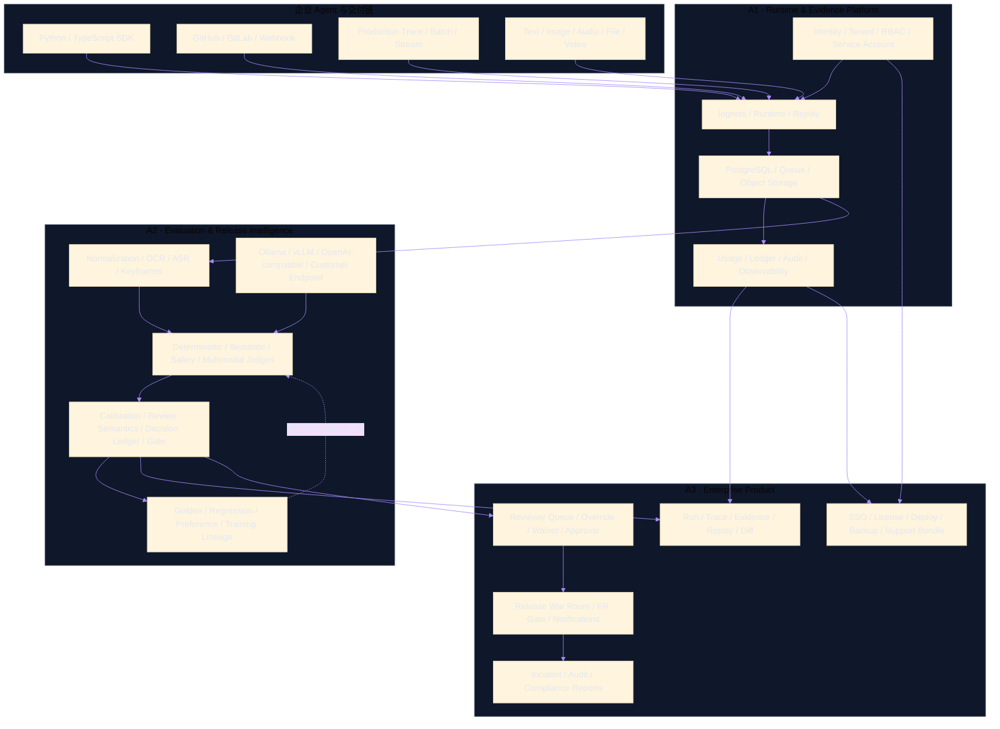

<div align="center">

# Ashr++

### Agent Release Intelligence Platform

**让 Agent 的每一次上线，都经过可重放、可评测、可审核、可签字的发布门禁。**

<p>
  
  
  
</p>
<p>
  
  
  
  
</p>

> **没有经过 Replay、Judge、Evidence、Review 与 Release Gate 的 Agent，不应该上线。**

</div>

---

## 产品定位

Ashr++ 不是通用聊天壳、工作流搭建器、评测脚本集合或只展示分数的 Dashboard。它面向需要把 Agent 放进正式生产流程的团队，解决五个直接影响采购决策的问题：

1. **上线前阻断风险**：把错误工具调用、越权、幻觉、敏感信息泄露和业务规则违背变成可执行发布门禁。
2. **线上事故可复现**：保存 Trace、Tool Call、Artifact、模型、Prompt、Policy 和构建版本，重放事故并比较修复前后行为。
3. **回归资产可沉淀**：把事故、人工修正、Override 和 Waiver 转化为有 Lineage 的 Golden、Regression 与 Learning Dataset。
4. **审核结论可签字**：机器判断、人工审核、例外审批和发布决定进入同一条不可抵赖证据链。
5. **企业环境可交付**：部署到客户自有云、专有云、VPC 或受限网络，并支持升级、回滚、备份、恢复、审计与诊断。

唯一战略总线：

[`docs/strategy/large-saas-a1-a2-a3-full-plan.md`](docs/strategy/large-saas-a1-a2-a3-full-plan.md)

---

## 三条产品 Lane

| Lane | 权责 | 交付价值 |
|---|---|---|
| **A1 · Runtime & Evidence Platform** | SDK、运行接入、Trace、Artifact、身份、租户、队列、存储、Usage、Billing Ledger、自托管基础设施 | 把真实 Agent 执行变成可信、可持久化、可重放的运行事实 |
| **A2 · Evaluation & Release Intelligence** | 多模态提取、Provider、模型、Judge、校准、审核语义、回归、学习数据、Decision Ledger、Release Gate | 判断一个版本能否上线，并用 Evidence 解释为什么 |
| **A3 · Enterprise Product & Workflow** | 控制台、Evidence Explorer、Review、Release War Room、报告、管理后台、集成、License 与运维体验 | 让研发、安全、合规、Reviewer 和负责人完成审核与签字 |

### 权威边界

- A1 运行成功不等于 A2 评测通过。
- A2 是评测语义和 Release Decision 的权威。
- A3 不得在浏览器中重算分数或自行拼装 `Release Ready`。
- 没有有效 Decision Ledger，不得允许发布。
- Override 与 Waiver 只能追加审计记录，不能覆盖机器原始结论。

---

## 从运行事实到发布决定

```mermaid
%%{init: {"theme": "base", "themeVariables": {"background": "transparent", "primaryTextColor": "#e2e8f0", "lineColor": "#22d3ee", "fontFamily": "Inter, ui-sans-serif, system-ui"}}}%%
flowchart LR
  classDef source fill:#111827,stroke:#64748b,color:#f8fafc,stroke-width:1.5px
  classDef a1 fill:#312e81,stroke:#a78bfa,color:#f8fafc,stroke-width:2px
  classDef a2 fill:#164e63,stroke:#67e8f9,color:#ecfeff,stroke-width:2px
  classDef a3 fill:#78350f,stroke:#fbbf24,color:#fff7ed,stroke-width:2px
  classDef pass fill:#064e3b,stroke:#34d399,color:#ecfdf5,stroke-width:2px
  classDef block fill:#7f1d1d,stroke:#fb7185,color:#fff1f2,stroke-width:2px

  Agent["Agent / SDK / CI / Production Trace"]:::source
  A1["A1<br/>Ingest · Persist · Replay · Diff"]:::a1
  Evidence["Versioned Trace<br/>Tool Calls · Artifacts · Provenance"]:::source
  A2["A2<br/>Extract · Judge · Calibrate · Decide"]:::a2
  Ledger["Evidence Snapshot<br/>Decision Ledger · Regression"]:::source
  A3["A3<br/>Review · War Room · Report · Audit"]:::a3
  Decision{"Release Decision"}:::source
  Ship["签字上线<br/>持续监测"]:::pass
  Stop["阻断发布<br/>复现 · 修复 · 重测"]:::block

  Agent --> A1 --> Evidence --> A2 --> Ledger --> A3 --> Decision
  Decision -->|"通过"| Ship
  Decision -->|"阻断 / 审核"| Stop
  Stop -. "事故与修正进入回归" .-> A2
```



---

## 系统架构



---

## 核心能力

### A1 · 生产接入与可信运行事实

- Python、TypeScript 与 Go 接入骨架；
- Run、Trace、Tool Call、Artifact 与失败分类；
- 本地与队列执行、重试、Dead Letter 和 Worker 恢复；
- API Key、路由 Scope、Quota、Usage 与 Billing Ledger 契约；
- PostgreSQL、对象存储和自托管基础设施切片；
- Replay、幂等、审计和 Evidence 完整性基础；
- Docker Compose 与 Terraform 参考资产。

### A2 · 独立评测与发布智能

- 确定性、语义、安全、Trace 与 Grounding Judge；
- Golden Case、失败分类、回归重放和 Release Policy；
- Evidence Snapshot、Decision Ledger 和持久化合同；
- Provider-neutral Gateway，支持 Ollama、vLLM、OpenAI-compatible 与客户自建端点；
- 校准、误报/漏报、人工一致率与漂移治理方向；
- 多模态提取、人工审核、Dataset Lineage 与受治理学习边界。

### A3 · 企业审核与商业工作流

- Run、Case、Report、Reviewer、Admin 与 Release 页面；
- Hosted Report、Share、Revoke、Expiry 与导出合同；
- RBAC 元数据、Fail-closed 写路径和 Event Outbox；
- GitHub Check、PR Comment、Waiver、Approval 与 Audit Bundle；
- Artifact Registry、Verifier、通知控制面和运维状态入口；
- 面向企业管理员、Reviewer、安全与合规角色的产品壳。

> 仓库中的代码、测试和契约代表可验证基础；它们不自动等同于生产验证。对外承诺必须经过部署、负载、故障、恢复和安全证据证明。

---

## Provider-neutral 模型路线

Ashr 官方 API 只作为**可选校准 Provider**，不是开发、CI、Release Gate 或企业运行的必需依赖。

```text
Ollama                开发、小型部署与离线 Profile
vLLM                  高吞吐自托管参考后端
OpenAI-compatible     标准化云端或私有 Endpoint
Customer Endpoint     客户自建模型服务
Ashr API              可选行为与字段校准来源
```

Provider 超时、限流、额度耗尽、付款异常、容量不足或响应不完整，都不能产生假 `Pass`。禁用任意单一 Provider 后，Evidence、Judge、Review 和 Release Gate 仍应保持可运行。

---

## 企业交付形态

| 档位 | 适用场景 | 交付重点 |
|---|---|---|
| **Developer** | 本地开发与契约验证 | Compose、可选 Ollama、Seeded Smoke |
| **Evaluation** | 小型 Kubernetes / VPC 验证 | PostgreSQL、对象存储、Queue、受治理模型后端 |
| **Enterprise HA** | 企业生产环境 | 多实例、SSO、KMS、扩缩容、完整观测与恢复 |
| **Restricted / Offline** | 受限网络、专有云、隔离环境 | 离线镜像与模型、私有 Registry、受控升级包 |

企业 Release 的目标制品包括：

- 签名 OCI 镜像；
- Helm Chart 与 Terraform 模块；
- Migration、兼容矩阵、升级与回滚工具；
- 备份、PITR、恢复和灾难演练说明；
- SBOM、Provenance、漏洞与许可证报告；
- 离线镜像/模型包；
- 自动脱敏 Support Bundle；
- 中文 Operator、Admin、Reviewer、SDK、API 与安全手册。

---

## 国内企业优先

产品优先考虑中文界面、中文错误、国内云/VPC、受限网络、企业微信、钉钉、飞书、GitHub/GitLab，以及企业合同与 License 交付。

在项目主体不具备营业执照及相应平台资质的条件下，以下能力不得标记为生产可用：

- 微信开放平台登录；
- QQ 互联登录；
- 支付宝登录；
- 微信支付商户收款；
- 支付宝商户收款。

这不阻碍企业私有化交付。身份优先采用客户 OIDC/SAML/LDAP、本地管理员、邮箱、MFA、服务账号和 Scoped API Key；商业交付优先采用合同、License、人工账单与对账。具备主体资质和平台审批后，在线支付以微信支付和支付宝为主要路线。

---

## 快速开始

```bash
git clone https://github.com/3351666087/ashr-codex-factory.git
cd ashr-codex-factory
```

### Python 合同与评测

```bash
python -B -m pytest tests/a1 tests/a2 -q
python -B scripts/a2_regenerate_fixtures.py --check
```

### A3 Node 合同

```bash
node --test tests/a3/*.mjs
```

### TypeScript SDK

```bash
npm install --prefix packages/ts/ashr-clone
npm test --prefix packages/ts/ashr-clone
```

### Go Runtime / API

```bash
cd packages/go/ashrclone
go test ./...
```

### A3 本地控制台

```bash
python -m http.server 5173
```

打开：

```text
http://127.0.0.1:5173/apps/dashboard/index.html
```

### 自托管配置校验

```bash
docker compose -f services/runner/docker-compose.a1.yml config --quiet
docker compose --env-file infra/docker/self-host.env.example \
  -f infra/docker/docker-compose.self-host.yml \
  --profile commercial config --quiet
```

---

## 常用工作流

### 运行 Agent 并生成 Trace

```bash
python -B -m services.runner.cli \
  --input docs/a1/evidence/local_agent_cases_30.json \
  --output /tmp/ashr_local_run.json \
  --agent examples.agents.mock_agent:RespondingMockAgent \
  --dataset-id a2-local-scenarios \
  --runner-id local-smoke \
  --max-workers 4 \
  --timeout 5 \
  --fail-on-case-failure
```

### 执行 A2 Judge 与 Release Policy

```bash
python scripts/a2_judge_service.py /internal/judge/case --input payload.json
python scripts/a2_judge_service.py /internal/release-policy/evaluate --input payload.json
```

### 生成 A3 Release Gate 结果

```bash
node services/report/a3_gate_cli.mjs \
  --runs fixtures/a3/mock_run_results.json \
  --grades fixtures/a3/mock_grade_results.json \
  --coverage fixtures/a2/results/a2_g3_coverage_report.json \
  --thresholds fixtures/a3/release_gate_thresholds.json \
  --json \
  --no-fail
```

---

## 仓库地图

```text
apps/dashboard/                    A3 控制台与产品工作流
apps/webapp/                       Web 应用边界
services/runner/                   A1 Runner、数据适配与 API 校准
services/api/                      A1 API、Queue、Control Plane、Usage/Billing
services/judge/                    A2 Judge、Policy、Calibration、Persistence
services/report/                   A3 Report、Gate、Review、Audit 与 Admin 服务
packages/sdk/ashr_clone/           Python SDK 与 Evidence 辅助能力
packages/ts/ashr-clone/            TypeScript SDK、Runtime 与 API parity
packages/go/ashrclone/             Go Runtime/API、PostgreSQL、Auth、Quota、Worker
packages/rust/ashr-runtime-verify/ Rust Evidence/Runtime Verifier
packages/scenarios/                A2 Scenario Packs
fixtures/a2/                       A2 Grade、Coverage、Calibration、Regression Fixture
fixtures/a3/                       A3 Gate、Report、Review、Audit、Admin Fixture
docs/a1/                           A1 Schema、API 校准与运行证据
docs/a2/                           A2 Taxonomy、Contract 与评测证据
docs/a3/                           A3 Product、Report、Audit 与商业工作流证据
docs/strategy/                     唯一 A1/A2/A3 企业 Release 战略
infra/docker/                      Self-host Compose
infra/terraform/                   Self-host Infrastructure Contract
tests/a1/                          A1 Python Tests
tests/a2/                          A2 Python Tests
tests/a3/                          A3 Node Tests
```

---

## Evidence Discipline

Evidence 是产品能力，不是开发副产物。

仓库可以跟踪：

- Schema 与字段名；
- 脱敏状态摘要；
- Fixture 结构；
- 可公开的 Readiness 与 Calibration 报告；
- Hash、Manifest 与 Provenance；
- 确定性测试输出；
- 指向私有证据的无敏感信息引用。

仓库不得包含：

- API Key、Bearer Token、Cookie 或原始 Share Token；
- 私有 Prompt、Response 或客户 Payload；
- 未脱敏账号、Quota、支付或 Provider 数据；
- 私有截图与仍然有效的 Signed URL；
- 跨租户 Evidence 或未经授权的 Learning Data。

真实 API 密钥只能从环境变量读取。真实校准必须记录目的、请求类型、响应字段、状态、Quota/Error、成本、私有证据位置和脱敏摘要。

---

## Release 不变量

```text
没有 Evidence Snapshot，不得形成 Release Decision
没有 Decision Ledger，不得显示 Release Ready
Provider Failure 不得转化为 Pass
人工 Override 不得删除机器原始决定
客户数据默认不得跨租户或用于训练
所有写操作必须具备 Actor、Request、Trace 与 Audit
所有企业制品必须可安装、可升级、可回滚、可恢复
```

<div align="center">

### Replay the facts. Judge the risk. Preserve the evidence. Gate the release.

</div>
